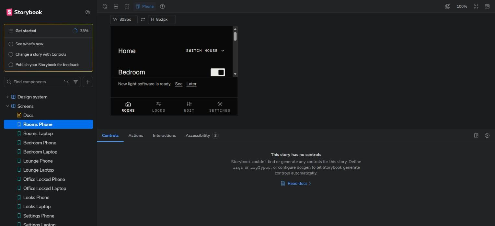
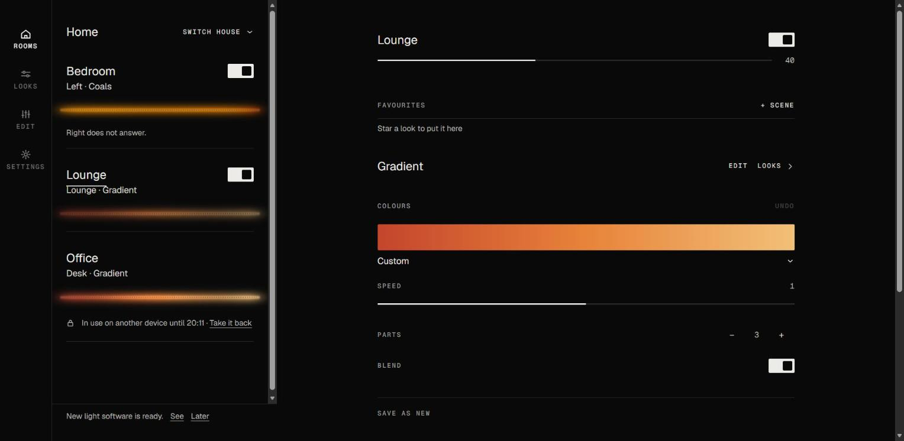
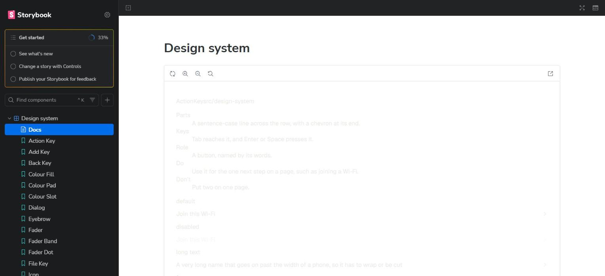
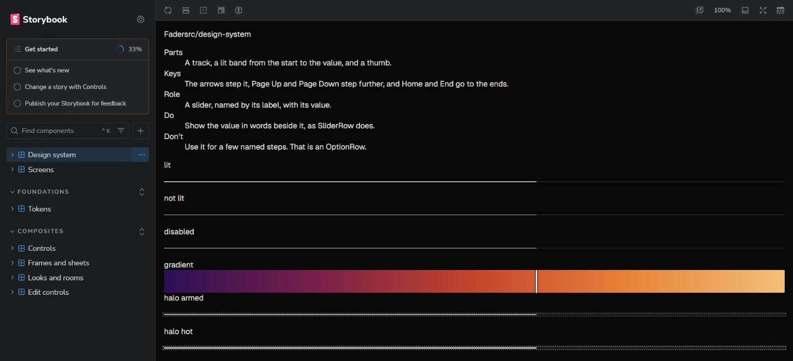
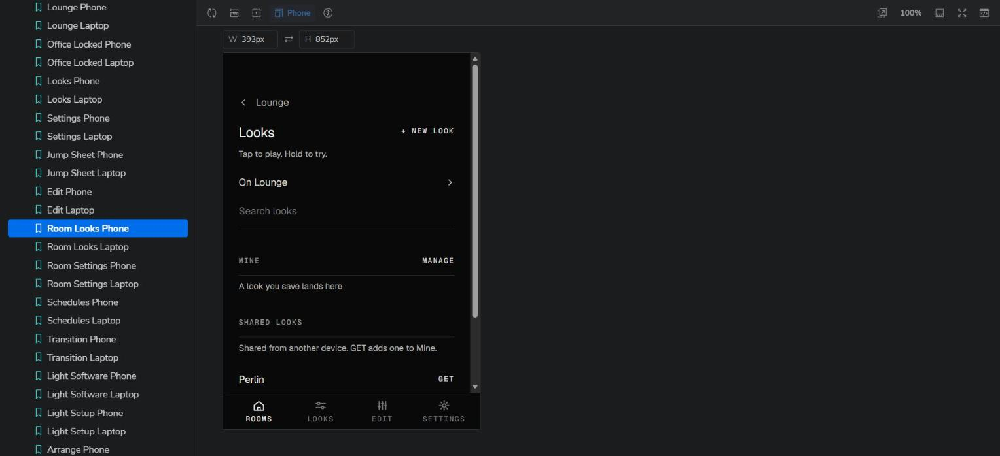
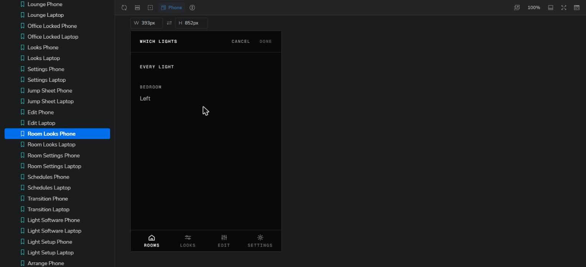

# User experience review: Storybook as the place to prototype, and Noa on the phone

Date: 2026-11-09. Build: branch `life-1986-storybook`, commit 85f5c01. Where: Storybook at `http://127.0.0.1:6006`,
in Chrome. Data: the made-up lights of `?demo`, no real light.

This review has two parts. Part A judges Storybook as the tool to build and judge a prototype (LIFE-1986). Part B
judges the app screens in it as persona 1, Noa.

## Who I was

- Part A: Ruan, building and judging a new screen from the design system's parts. Laptop, 1528 x 698 window.
- Part B: Noa (P1), turns the Lounge on in the evening and picks a warm look. Wants a warm room in two taps. Low
  patience. Phone frame, 393 x 852.

## Tasks

| Story | Task | Target (Should take) | Actual taps | Result |
| -- | -- | -- | -- | -- |
| A | See one phone screen whole | 0 | 1 (close the panel) | the screen is still cut, it scrolls inside the frame |
| A | Read the notes and states of all primitives on one page | 0 | 0 | cannot read, light text on white |
| A | Change a component's props to try a variant | some taps in Controls | not possible | no controls on any story |
| P1-S3 | Play a warm look in the Lounge from Home | 2 taps | 3 taps to the Looks page, then stuck | no look to play |

## Findings, Part A: Storybook as the prototype tool

### UX-01 Major: the addon panel crops the phone screen to two rows
- Screen: any Screens story, phone size.
- Did: opened Rooms Phone.
- Happened: the Controls, Actions and Accessibility panel takes half the height. The phone shows Home and Bedroom
  only. With the panel closed, the 852 px phone still does not fit a 698 px window, so it scrolls inside its frame.
- Expected: the whole phone screen at once, scaled to fit.
- Why it matters: judging a screen means seeing all of it. Every look starts with two clicks of setup.
- Evidence: 

### UX-02 Minor: a story opened on its own draws at the window width
- Screen: `iframe.html?id=screens--lounge-phone`.
- Happened: the "Phone" story draws as a laptop, because the phone size is set by Storybook's frame only.
- Expected: a phone story is a phone in every view, so a link to it can be shared.
- Evidence: 

### UX-03 Minor: Storybook's own "Get started" box sits over the menu
- Screen: every page.
- Happened: a box with "See what's new", "Change a story with Controls" and "Publish your Storybook" takes the top
  of the menu.
- Expected: no box. It is not this project's job.
- Evidence: every screenshot in this folder.

### UX-04 Major: the Docs pages cannot be read
- Screen: Design system / Docs, and every other Docs page.
- Happened: the app's light text and lines draw on Storybook's white Docs page, so the notes and states are almost
  invisible.
- Expected: the Docs page in the app's dark colours.
- Evidence: 

### UX-05 Blocker for prototypes: no component can be changed in Storybook
- Screen: every Design system and Composites story.
- Did: opened Fader, then the Controls tab.
- Happened: each story is one fixed specimen page, with every state stacked. Controls says "This story has no
  controls". To try a different label, value or state, I must edit a specimen file.
- Expected: one story per state, with its props in Controls, so a prototype is a few clicks.
- Why it matters: the reason for Storybook is quick prototypes. Today it is a catalogue, not a workbench.
- Evidence: 

### UX-06 Polish: the specimen header runs the name into the path, and the notes show twice
- Screen: every component story.
- Happened: the header reads "Fadersrc/design-system". The notes show in the story, and again in the Docs
  description.
- Expected: the name, then the layer, apart. The notes in one place.
- Evidence: 

## Findings, Part B: Noa on the phone

### UX-07 Blocker in Storybook: the made-up house has no looks
- Screen: Room Looks Phone (Lounge).
- Did: Home, Lounge, LOOKS, to play a warm look.
- Happened: Mine is empty ("A look you save lands here"). Shared looks has one item, "Perlin", with the line "As
  authored, Test". There is nothing warm to play.
- Expected: the same made-up looks the story tests use (Candle, Starfield), so every look screen can be judged.
- Why it matters: the main job of the app cannot be seen or judged in Storybook. "As authored, Test" is test text
  that a person sees.
- Evidence: 

### UX-08 Major: "On Lounge" opens a light picker, and the Lounge light is not in it
- Screen: Room Looks Phone.
- Did: tapped "On Lounge", to find the looks on the Lounge.
- Happened: a "WHICH LIGHTS" sheet opens with EVERY LIGHT and Bedroom / Left. The Lounge light is not in the list.
- Expected as Noa: "On Lounge" with a chevron reads as a place with more looks, not as a choice of lights. If it
  picks lights, it should list the light it names.
- Evidence: 

### UX-09 Major: the room screen leads with look controls, and a warm look is 3 taps or more
- Screen: Lounge Phone.
- Happened: under the room name come FAVOURITES (empty), then the look's COLOURS, SPEED, PARTS, BLEND and SAVE AS
  NEW. Looks to pick are one more tap away, behind LOOKS. P1-S3 asks for 2 taps.
- Expected as Noa: a few looks to tap on the room screen itself. The controls of a look are for Tess (P2).
- Why it matters: Noa's whole job is one look, and the screen shows the tools of another persona first.
- Evidence: the Lounge screen in Storybook, Lounge Phone.

### UX-10 Minor: the software notice stays on Home for everyone
- Screen: Rooms Phone.
- Happened: "New light software is ready. See Later" sits above the bar and covers the Office card.
- Expected: a job for Bram (P3) in Settings. Noa does not update software.
- Evidence: 

## What felt good and must stay

- The strips on Home show each room's look at a glance, and they match the light.
- The type is calm and consistent: small capital labels, one size for names, no colour accents.
- The token tables read the live values, so the light theme and more contrast show as they are.
- All 38 screens open at the right place on made-up lights, with no light reached.

## Summary

| Severity | Count |
| -- | -- |
| Blocker | 2 (UX-05, UX-07) |
| Major | 4 (UX-01, UX-04, UX-08, UX-09) |
| Minor | 3 (UX-02, UX-03, UX-10) |
| Polish | 1 (UX-06) |

Ticket groups:

- Storybook as a workbench: UX-01 to UX-07.
- Noa's path to a look: UX-08 to UX-10.
